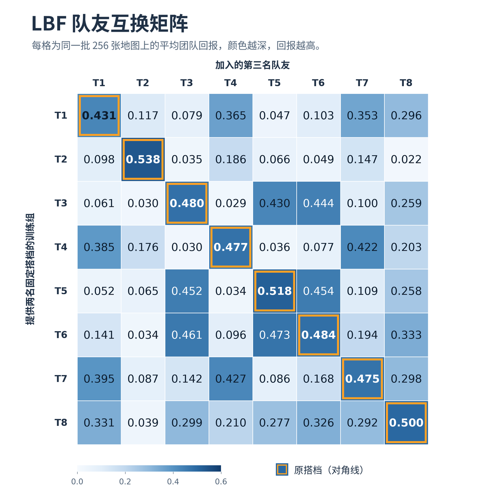

# QMIX 基线：队友生成与 ego 训练

本模块用于在 LBF（协作采食）、PP（追捕）和 CN（协作导航）中复现 vanilla QMIX 基线。先联合训练三名角色，冻结其中一名作为队友，再从头训练两个受控角色（ego），使它们能与不同队友配合。

## 代码入口

| 部分 | 实现 |
| --- | --- |
| 智能体网络 | 每个 ego 根据局部观测、上一步动作和角色编号选动作。两个 ego 共享 64 维 GRU 的参数，各自保留记忆。[网络与权重加载](../fastap_agents/local_q.py) · [网络配置](../configs/agents/drqn.yaml) |
| QMIX 训练方法 | 沿用 EPyMARL 的局部 Q 网络和单调混合网络。项目的批量学习器从回放中采样完整回合，用全局状态将受训角色的 Q 值合成为团队 Q 值。[学习器](../fastap_methods/batched_qmix.py) · [方法配置](../configs/methods/qmix.yaml) |
| 队友生成 | 训练一支三人队伍，按验证成绩选择检查点，导出第 3 个角色。更换种子重复训练即可得到不同队友。[单队友训练](../fastap_methods/single_teammate.py) · [队友池生成](../scripts/generate_teammate_pool.py) · [交叉评估](../fastap_methods/pool_crossplay.py) |
| ego 训练 | 加载同一场景的冻结队友，更新两个 ego 的共享网络和混合网络。训练时按回合抽队友，训练后分别与池中各队友测试。[ego 训练入口](../scripts/train_pool_ego.py) |

## 运行示例：CN 混合训练

先按根目录说明安装 EPyMARL，再在仓库根目录用 Bash 依次运行。首次运行从 T1 开始生成本地权重。训练入口检查物理 GPU 2 的剩余显存和共享预算。[环境安装](../README.md#qmix--lbf-环境)

```bash
source scripts/epymarl-env.sh

# 1. 联合训练三名导航者，导出第一名冻结队友 T1
envs/epymarl/bin/python -m qmix_baseline train-teammate outputs/cn_t1_demo \
  --scene cn --seed 101 --num-envs 32 --total-steps 2000000 \
  --eval-maps 256 --heldout-seed 1810000 --no-bootstrap-at-time-limit

# 2. 复用 T1，以相同配置和不同种子训练 T2–T8，生成队友池
envs/epymarl/bin/python -m qmix_baseline generate-pool outputs/cn_pool_demo \
  --scene cn --base-run outputs/cn_t1_demo --size 8

# 3. 每局从八名冻结队友中抽一名，训练两个 ego
envs/epymarl/bin/python -m qmix_baseline train-ego outputs/cn_ego_demo \
  --scene cn --teammate-pool outputs/cn_pool_demo/pool.json \
  --seed 1107 --num-envs 32 --total-steps 2000000 \
  --validation-seed 4100000 --heldout-seed 4200000 --no-bootstrap-at-time-limit
```

本例每局 25 步，第 25 步的训练目标只含当步奖励。每支队伍各训练 200 万个环境步，两个 ego 再共同训练 200 万步。队友训练使用原始奖励，ego 训练在计算目标前标准化奖励，测试报告始终记录原始团队回报。队友池的搭配结果见 `outputs/cn_pool_demo/crossplay.json`，两个 ego 与各队友的独立测试见 `outputs/cn_ego_demo/heldout.json`。

## LBF 队友互换结果



每行固定同一训练队伍的前两名角色，每列指定加入的第 3 名队友。每格是三人在同一批 256 张地图上的**平均团队回报**，蓝色越深，回报越高。橙框标出的 8 组原搭档平均为 **0.488**，其余 56 组互换搭档平均为 **0.200**。
